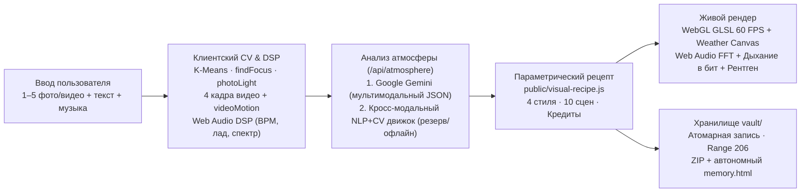

# DayTrace — Ящик с пластинками

> **ArtTech · Make the Invisible Visible**  
> Личный визуально-музыкальный дневник, который превращает реальные фотографии, видео, текст и музыку дня в живой **архивный контактный лист 4:5**, **разворот винилового конверта (Gatefold)** и **топографическую карту памяти**.


**DayTrace не генерирует фейковые изображения вместо фотографий пользователя.** Вся эстетика — цветокор, паспарту, типографика, композиция, погодный шейдер, ритм дыхания кадра и звуковой автограф — **непрерывно вычисляется из реальных данных дня** (текст + фото/видео + аудио).

---

## Содержание

1. [Ключевые возможности и фичи](#ключевые-возможности-и-фичи)
2. [Архитектура и пайплайн данных](#архитектура-и-пайплайн-данных)
3. [Алгоритмы под капотом](#алгоритмы-под-капотом)
4. [10 живых атмосферных сценариев](#10-живых-атмосферных-сценариев)
5. [Структура репозитория](#структура-репозитория)
6. [HTTP API и безопасность](#http-api-и-безопасность)
7. [Быстрый запуск и настройка `.env`](#быстрый-запуск-и-настройка-env)
8. [Тестирование](#тестирование)

---

## Ключевые возможности и фичи

### 1. «Ящик с пластинками» и Топографический роадмап (`/`)
* **Эстетика Blue Note × Фотолаборатория:** каждый день в архиве представлен как коллекционный виниловый конверт с выезжающим при наведении и вращающимся в такт BPM виниловым диском, а лицевая обложка — **архивный контактный лист 4:5** с калибровочной шкалой `■ ■ ■ ■` из 4 реальных цветов дня.
* **Зигзагообразная карта и гладкий топографический роадмап (`public/roadmap.js`):**
  * Органические изолинии фона и волнистые контурные линии между рядами и соседними карточками строятся динамически с помощью **центрипетальных сплайнов Катмулла–Рома ($\alpha = 0.5$)** и аналитических нормалей — без заломов и пересечений на любых экранах.
  * Вдоль маршрута автоматически расставляются флажки и реальные метки дней (дата, BPM, атмосфера), а при наведении на узлы видны сводки переходов (`78 → 132 BPM · Туман → Дождь на стекле`).
* **Journey Mode — «Проиграть маршрут»:**
  * Красная пульсирующая игла-маячок плавно едет по волнистой трассе роадмапа от карточки к карточке, оставляя подсвеченный след, скролля страницу, выдвигая винил и автоматически проигрывая саундтрек каждого дня.
  * Внизу работает пульт маршрута с прогресс-баром, переключением остановок и аналитикой переходов; клик по любому флажку на карте запускает маршрут с этой точки.
* **Физика времени — ползунок «На полке — Сейчас»:**
  * Управляет визуальным старением обложек (`public/patina.js`): приглушение красок, тёплое выцветание и аутентичная виниловая потёртость (`ring-wear`).
  * Одновременно управляет **звуковым старением** в `Web Audio API` (`setVinylAging`): мягкий low-pass фильтр + деликатный генеративный треск старой виниловой пластинки.
* **Жанровые разделители и сортировка:** картонные табы-разделители по настроениям (*Весь ящик / Спокойствие / Радость / Мечтательность / Энергия*), избранное, сортировка по дате, теплоте и BPM.

### 2. «Слепок архива» — генеративный виниловый постер LP (`public/vinyl-poster.js`)
* Превращает все видимые дни архива в **единый музейный виниловый постер (`1400×1750`, 4:5)** — data-art портрет сезона.
* **Каждое концентрическое кольцо = один день:**
  * цвет взят из реальной K-Means палитры дня;
  * рельеф микро-бороздок модулирован реальной 56-точечной волной громкости трека (`envelope`), BPM, энергией и динамикой видео (`videoMotion`).
* В центре — этикетка с круговой диаграммой настроений и средним BPM; внизу — цветовой ДНК-штрихкод всего архива.
* **Интерактив:** наведение на любую бороздку подсвечивает конкретный день и его параметры, клик открывает день. Доступны **2 темы печати** (*«Тёмный винил»* и *«Бумажный оттиск»*) и экспорт в PNG высокого разрешения.

### 3. Разворот конверта (Gatefold), WebGL 60 FPS и «Рентген-слой» (`/day/:id`)
* **Живой контактный лист 4:5 (WebGL + Canvas 2D):** отображает все 1–5 фото и видео дня одновременно в одном из 4 параметрических художественных режимов с кастомным GLSL-шейдером.
* **Дыхание кадра в такт биту:** гладкая косинусная кривая, синхронизированная с точным BPM дня + живым FFT-басом (`BASS`), плавно управляет оптическим зумом кадра (~5%), тёплым ореолом света (`halation`) и пульсацией акцентной рамки — работает как на встроенном аудио, так и на карточках со Spotify.
* **«Рентген-слой» (Live Signal Blueprint — кнопка «Рентген», удержание `Space` или клавиша `X`):**
  * В реальном времени накладывает поверх холста инженерный чертёж:
    * прицелы компьютерного зрения `CV FOCUS` в вычисленных фокусных точках каждого слота;
    * извлечённую палитру **K-Means** с hex-кодами и живую телеметрию рецепта (`MODE`, `BRUSH px`, `SPACE %`, `SAT`, `CON`, `MIST`, `VID`);
    * живой 3-полосный FFT-анализатор (`BASS / MID / HIGH`) и вращающиеся часы фазы бита (`BEAT`).
* **Оборот конверта (Liner Notes):** полный рассказ с буквицей, **Сторона A** (переключение кадров и лупа) / **Сторона B** (плеер, интерактивная перемотка по волне, Spotify Embed, озвучка дня), честные **«Кредиты» в процентах** (вклад текста, фото/видео, погоды и аудио).
* **Лупа («Оригинал / Арт-слой»):** масштабирование до `4×` и сравнение обработанного слоя с честным оригиналом (работает и для фото, и для видео).
* **«Почему так?» и «Сравнить музыку»:** подробная расшифровка всех сигналов + возможность в один клик переключить трек-этюд и увидеть, как музыка на лету перестраивает композицию, цвет и ритм.
* **Экспорт и управление:** скачивание **PNG**, запись **15-секундного видеоклипа WebM/MP4** со звуком, выгрузка **ZIP-архива** с полностью автономной офлайн-открыткой `memory.html`, публичный шаринг по отзываемой ссылке и **безопасное удаление записи** с подтверждением.

### 4. Создание дня с поддержкой видео, Google Фото и аудио (`/create`)
* **Медиа (1–5 файлов):** фото JPEG/PNG/WebP/GIF/AVIF до **50 МБ** и видео MP4/WebM/MOV/OGG до **250 МБ**.
* **Способы загрузки:** перетаскивание, выбор файлов, рекурсивный импорт **«Из папки»** и прямой вход **«Из Google Фото»** через официальный **Google Photos Picker API** (выбор любых отдельных фото и видео без скачивания архива).
* **Умный фокус кадра:** кнопка **«Фокус»** на каждой миниатюре показывает точку внимания, найденную алгоритмом `findFocus`, и позволяет скорректировать её вручную.
* **Музыка дня:** автоподбор из Spotify (встроенный каталог из 16 треков + живой Spotify Web API), загрузка собственного аудиофайла (до 50 МБ) с полным DSP-анализом в браузере, либо ссылка (поддержка Deezer BPM API) + кнопка **«Настучать ритм»** (Tap Tempo).
* **Озвучка дня:** генерация голоса с темпом и тембром, вычисленными из энергии, ритма текста и звучания трека.

---

## Архитектура и пайплайн данных

Весь проект построен на **чистом Node.js ≥ 22 и нативных браузерных API** — **ноль внешних npm-зависимостей**.



---

## Алгоритмы под капотом

### 1. Компьютерное зрение (`public/analysis.js`, `public/composition.js`)
* **K-Means кластеризация (`colorProfile`):** итеративно выделяет до 5 доминантных цветов из всех фото и ключевых кадров видео. Из них строятся калибровочная шкала, цвет паспарту, тонированные рамки и тёмный фон страницы дня — никаких чужеродных шаблонных цветов и белых рамок.
* **Расширенная световая телеметрия (`photoLight`):** для каждого фото и видеокадра вычисляются `luma` (светлота), `contrast` (СКО яркости), `warmth` (цветовая температура), `chroma` (насыщенность), `darkShare` / `brightShare` (доля глубоких теней и ярких светов) и круговой `dominantHue` (`0–360°`).
* **Карта визуальной значимости (`findFocus`):** строит интегральное изображение (Summed Area Table) по локальным градиентам контраста и отличию от среднего цвета, находя смысловой центр кадра за $O(N)$ — используется для кадрирования в 4:5 и отображается в «Рентгене».
* **Анализ видео (`preparePhoto`):** автоматически снимает до 4 опорных кадров по таймлайну (`10% / 38% / 66% / 90%`), вычисляет межкадровую разницу пикселей `videoMotion` и отслеживает сдвиг освещения во времени (`deltaLuma`).

### 2. Кросс-модальный анализ текста и визуала (`server/atmosphere.mjs`, `server/rule-atmosphere.mjs`)
* **Google Gemini API (при наличии `GEMINI_API_KEY`):** получает текст, все уменьшенные фото и промаркированные ключевые кадры видео с таймкодами и `videoMotion`, возвращает структурированный JSON по строгой схеме (с проверкой, что `quote` дословно присутствует в тексте автора).
* **Отказоустойчивый кросс-модальный NLP + CV движок (`analyzeRuleAtmosphere`):** работает мгновенно без ключей и интернета:
  * **NLP с областью отрицания:** отслеживает частицы `не / ни / без / нет / не было` внутри клауз (*«дождя не было»* не включает дождь, *«не радостная встреча»* не даёт радость) и усиливает вес фраз после противительных союзов (`но / зато / однако`, множитель `1.65×`).
  * **Пунктуационный ритм:** `!` усиливает энергию/радость, `…` смягчает в мечтательность.
  * **Кросс-модальное слияние (`fuseMood`):** объединяет текстовые маркеры с визуальной телеметрией кадров и динамикой видео. Даже при нейтральном тексте тёмный холодный кадр ведёт к `dream` + *Звёздная ночь*, тёмный тёплый кадр с лампами — к *Огни и боке*, тёмный контрастный неон — к `energy` + *Огни мегаполиса*, светлый морозный — к *Снег и тишина*, а сочная листва — к *Листья и ветер*.

### 3. Браузерный Audio DSP (`public/analysis.js`, `public/spectral-profile.js`, `public/media.js`)
* **Оценка BPM (`pulseBpm`):** строит огибающую атак (`onset envelope`) и находит основной период через автокорреляцию с параболической интерполяцией пика; дополнительно интегрирован Deezer BPM API и ручной Tap Tempo (`public/rhythm.js`).
* **Определение лада `major / minor` (`tonalMode`):** считает хромаграмму по 48 полутонам (4 октавы) через **фильтр Гёрцеля** и сравнивает распределение с 12 транспозициями профилей **Крумхансла–Шмуклера**.
* **Спектральный профиль:** рассчитывает спектральный центроид (Гц), яркость (`brightness`), ударность (`percussiveness` / positive spectral flux) и 56-точечную огибающую для Звукового автографа и винилового постера.
* **Живой 3-полосный FFT (`audioBands`):** `AnalyserNode` (512 отсчётов) в реальном времени разделяет играющий звук на `BASS` (20–150 Гц), `MID` (150–2000 Гц) и `HIGH` (2000–12000 Гц).

### 4. Параметрический визуальный рецепт (`public/visual-recipe.js`, `public/postcard.js`)
Оформление карточки вычисляется непрерывно без жёсткой привязки к категории `mood`:
* **4 художественных режима контактного листа** (работают для 1–5 фото/видео):
  1. **Импрессионизм (Моне)** — свободные этюды с мягким нахлёстом и акварельной линией звука.
  2. **Конструктивизм (Кандинский)** — жёсткая асимметричная 1px-сетка и бит-реактивная силовая ячейка (`powerCell`).
  3. **Японский минимализм (Ма / Ваби-саби)** — до 45% чистого «воздуха», тонкие типографские метки реза и каллиграфическая линия.
  4. **Киноплёнка 35mm** — широкий кинокадр + лента-раскадровка с перфорацией, таймкодами и вертикальной оптической звуковой дорожкой справа.
* **Конфликт модальностей:** яркий снимок + уставший текст не затемняют кадр искусственно — свет сохраняется, но добавляются тёплая дымка, приглушённая насыщенность, больше воздуха и замедленный дрейф.

---

## 10 живых атмосферных сценариев

Каждый сценарий работает одновременно на **полноэкранном погодном слое** (`public/weather.js`, `public/weather.css`) и прямо внутри **WebGL GLSL-шейдера карточки 4:5** (`public/day.js`), поддерживая «протирание» курсором и плавное монотонное время без рывков:

| Код | Название | Визуальный эффект и цветокор |
| --- | --- | --- |
| `warm_haze` | **Тёплая дымка** | Рассеянный золотистый свет, мягкая дымка и парящая тёплая пыльца. |
| `mist` | **Туман** | Слоистые дрейфующие полосы тумана и смягчённый контраст. |
| `rain_glass` | **Дождь на стекле** | Струящиеся капли дождя и влажные блики на стекле. |
| `wind_sparks` | **Ветер и искры** | Порывы ветра, световые штрихи и летящие искры движения. |
| `clear_light` | **Ясный свет** | Чистые солнечные лучи сверху и прозрачный воздух без затемнения. |
| `snow_drift` | **Снег и тишина** | Объёмный 3D-дрейф снежинок на синусоидальном ветру и прохладные света. |
| `starlight` | **Звёздная ночь** | Мерцающее звёздное поле, тонкие линии созвездий, редкий метеор и индиго-тени. |
| `amber_bokeh` | **Огни и боке** | Тёплые расфокусированные огни свечей/фонарей с мягким ореолом (`halation`). |
| `petal_drift` | **Листья и ветер** | Кружащиеся листья/лепестки, окрашенные в **родную K-Means палитру** дня. |
| `neon_pulse` | **Огни мегаполиса** | Ночные бирюзово-пурпурные световые шлейфы, усиленный контраст и графика. |

---

## Структура репозитория

```text
.
├── package.json                  # Скрипты запуска и тестов (0 внешних зависимостей)
├── .env.example                  # Шаблон переменных окружения
├── vault/                        # Локальное хранилище дней (создаётся автоматически)
└── genesis-main/                 # Основное приложение DayTrace
    ├── server.mjs                # HTTP-сервер, маршрутизация API, Range 206, CSP/безопасность
    ├── server/
    │   ├── vault.mjs             # Атомарное хранилище, валидация медиа, шаринг, удаление, ZIP
    │   ├── atmosphere.mjs        # Мультимодальный анализ через Google Gemini API + JSON-схема
    │   ├── rule-atmosphere.mjs   # Автономный кросс-модальный NLP + CV движок (10 сценариев)
    │   ├── music.mjs             # Каталог Spotify, Spotify Web API, Deezer BPM API
    │   ├── google-photos.mjs     # Прокси-сессии Google Photos Picker API (фото =d и видео =dv)
    │   ├── portable.mjs          # Генератор автономного офлайн-файла memory.html для ZIP
    │   ├── voice.mjs             # Синтез озвучки дня (Windows SAPI WAV)
    │   ├── cover-text.mjs        # Выделение и нормализация подписи для обложки
    │   └── zip.mjs               # Встроенный генератор ZIP без сторонних библиотек
    ├── public/
    │   ├── index.html            # SPA-оболочка приложения
    │   ├── app.js                # Роутер, «Ящик с пластинками», Journey Mode, старение, фильтры
    │   ├── roadmap.js            # Топографический фон и гладкий сплайновый роадмап
    │   ├── vinyl-poster.js       # Генеративный виниловый постер «Слепок архива» (PNG 1400×1750)
    │   ├── create.js / create.css# Форма создания дня, импорт фото/видео, фокус, Tap Tempo
    │   ├── day.js / day.css      # Gatefold-разворот, WebGL-шейдер, дыхание в бит, Рентген, Лупа
    │   ├── weather.js / .css     # Полноэкранный движок 10 атмосферных эффектов
    │   ├── visual-recipe.js      # Параметрический движок оформления и «Кредитов»
    │   ├── postcard.js           # Геометрия 4:5 контактных листов и Звуковых автографов
    │   ├── analysis.js           # K-Means, photoLight, videoMotion, Audio DSP (BPM, Гёрцель)
    │   ├── composition.js        # Алгоритм внимания findFocus (интегральное изображение)
    │   ├── media.js              # Web Audio граф, 512-FFT, память-фильтр и виниловый треск
    │   ├── patina.js             # Модель выцветания обложек со временем
    │   ├── deck.js / deck.css    # Интерактивная колода кадров
    │   ├── rhythm.js             # Tap Tempo и интервалы смены кадров
    │   ├── spectral-profile.js   # Расчёт спектрального центроида и ударности аудио
    │   ├── google-photos.js      # Клиент Google Identity Services + Picker API
    │   ├── spotify.js            # Встроенный плеер Spotify Embed
    │   └── demo.json             # 9 демонстрационных дней (включая контрольную пару)
    └── tests/                    # 49 автотестов (node --test)
```

---

## HTTP API и безопасность

Все мутирующие и приватные маршруты защищены проверкой владельца (`localhost` + Same-Origin/CSRF-защита), а публичные ссылки работают строго по 32-символьным криптографическим токенам с изоляцией медиа:

| Метод и маршрут | Назначение |
| --- | --- |
| `GET /api/days` | Список всех дней архива |
| `POST /api/days` | Создание нового дня (атомарная запись в `vault/`, генерация `memory.html` и `voiceover.wav`) |
| `GET /api/days/:id` | Получение полной записи дня |
| `DELETE /api/days/:id` | Удаление папки дня, медиа и отзыв его публичной ссылки |
| `PUT /api/days/:id/favorite` | Добавить / убрать день из избранного |
| `PUT /api/days/:id/track` | Сменить сохранённый трек дня (обновляет `memory.html` и `memory.json`) |
| `GET /api/days/:id/zip` | Скачать полный ZIP-архив дня с автономным `memory.html` |
| `POST /api/atmosphere` | Анализ текста, фото и ключевых кадров видео (Gemini или кросс-модальный движок) |
| `GET /api/atmosphere/status` | Текущий активный провайдер анализа |
| `GET /api/music` · `GET /api/music/deezer/:id` | Автоподбор Spotify и получение BPM из Deezer |
| `GET/POST/DELETE /api/google-photos/*` | Сеансы и скачивание медиа из Google Photos Picker API |
| `GET/PUT /api/share/archive` · `/api/share/day/:id` | Включение / отзыв ссылок для просмотра |
| `GET /media/:id/*` | Отдача фото, аудио и потокового видео с поддержкой **`HTTP Range 206`** |

---

## Быстрый запуск и настройка `.env`

Требуется **Node.js 22** или новее. Внешние пакеты устанавливать не нужно.

```powershell
# Из корня репозитория (или из папки genesis-main)
npm start
```

После запуска откройте в браузере: **http://127.0.0.1:4173**

### Опциональная настройка `.env`
Скопируйте `.env.example` в `.env` в корне репозитория и заполните нужные ключи (без них всё продолжает работать автономно):

```env
# Мультимодальный анализ текста, фото и кадров видео через Google Gemini
GEMINI_API_KEY=
GEMINI_MODEL=gemini-2.5-flash

# Прямой импорт фото и видео через Google Photos Picker API (OAuth Web Client ID)
GOOGLE_PHOTOS_CLIENT_ID=

# Живой поиск треков через Spotify Web API (без ключей работает встроенный каталог)
SPOTIFY_CLIENT_ID=
SPOTIFY_CLIENT_SECRET=
SPOTIFY_MARKET=KZ

# Адрес и порт локального сервера
DAYTRACE_HOST=127.0.0.1
PORT=4173
```

---

## Тестирование

```powershell
npm test
```

В проекте **49 автоматических unit- и интеграционных тестов** на встроенном раннере `node --test`:
* структурированный анализ Google Gemini, обработка ошибок/таймаутов и защита от галлюцинаций цитат;
* кросс-модальный NLP+CV движок (отрицания, контрастные союзы, видеодинамика, все 10 сценариев);
* параметрический движок, независимость каналов BPM/лада/спектра, контрольная пара дней и 4 раскладки контактного листа (1–5 кадров);
* компьютерное зрение `findFocus`, аудио-DSP, каталог Spotify и Deezer BPM;
* сохранение в `vault/`, видеопотоки `Range 206`, импорт видео из Google Фото, шаринг и отзыв токенов, удаление записей (`DELETE /api/days/:id`), ZIP-экспорт и исполнение автономного `memory.html`.

---

## Шрифты и медиа-ресурсы
* Шрифты: **Oswald**, **Literata**, **Onest**, **Cormorant Garamond**, а также локальные **Manrope** и **Lora** (SIL Open Font License, лицензии в `genesis-main/public/fonts/`).
* Демонстрационные фотографии природы и города с Unsplash и синтезированные свободные аудио-этюды (`after-exam.wav`, `last-apartment.wav`, `office-night.wav`).
